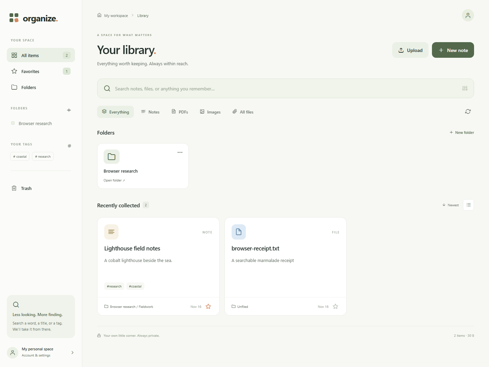

# Organize

A search-first personal library for notes, PDFs, images, documents, and other files. Save information in nested folders, add tags, and find it again by title, filename, keyword, or supported file content. Built for iOS, Android, and web.



[Mobile preview](docs/images/mobile.png) · [Setup](docs/SETUP.md) · [Contributing](CONTRIBUTING.md) · [MIT license](LICENSE)

## Project status

The client and API are implemented and locally verified: 23 unit/service/PDF tests, 6 Docker PostgreSQL API tests, and 2 browser flows pass. Full TypeScript checks, Expo SDK 57 compatibility, and the web export also pass. Live provider checks and native-device testing remain pending. Documentation was written before application code; changes are saved in focused local commits.

The sign-in screen includes a clearly labeled sample workspace for trying the interface without credentials. Screenshots use synthetic data. See [implementation progress](docs/PLAN.md) and [verification evidence](docs/VERIFICATION.md) for the exact scope.

## What you can do

- Sign in with an email code and a revocable session.
- Create nested folders and write or edit plain-text notes.
- Upload files to private Cloudinary storage and open authorized downloads.
- Search titles, filenames, tags, notes, and extracted text from supported PDFs and text files.
- Filter by type, folder, tag, or favorite; move items to Trash and restore them.
- Use a responsive library on phones, tablets, and desktop browsers.

## Get started

Use Node.js 24 LTS and Docker Desktop. From the repository root:

```sh
npm ci
npm run setup
npm run db:up
npm run db:migrate
npm run dev:api
```

In a second terminal, run `npm run dev:mobile` for Expo or `npm run dev:web` for the browser. Fill in Mailtrap and Cloudinary values in `apps/server/.env` for real sign-in and uploads. The sample workspace works without these credentials. See [setup](docs/SETUP.md) for device URLs, Neon, Resend, and test commands.

## Stack

| Layer          | Technology                                                 |
| -------------- | ---------------------------------------------------------- |
| Client         | Expo SDK 57, React Native, TypeScript                      |
| API            | Node.js, TypeScript, Fastify, Zod                          |
| Database       | PostgreSQL and Drizzle; Docker locally, Neon in production |
| Files          | Cloudinary, private authenticated assets                   |
| Authentication | Email and one-time code; revocable opaque sessions         |
| Email          | Mailtrap SMTP in development, Resend in production         |

## Repository map

```text
apps/
  mobile/                 Expo application
    src/
      components/         Reusable UI
      features/           Auth, library, folders, notes, files
      hooks/              Shared hooks
      lib/                API client, session storage, configuration
      theme/              Colors, spacing, typography
  server/                 Fastify API
    drizzle/              Versioned SQL migrations
    src/
      config/             Validated environment
      db/                 Drizzle schema, connection, migrations
      lib/                Errors and security helpers
      modules/            Feature routes, services, repositories
      providers/          Email, Cloudinary, content extraction
packages/
  contracts/              Shared request validation and response types
docs/                     Requirements, architecture, API, setup, progress
scripts/                  Environment setup and separated local commits
```

## Development and verification

```sh
npm run check
npm run test:db:up
npm run test:integration
npx --no-install playwright install chromium --only-shell
npm run test:browser
```

Stop the development API before browser verification; the suite uses ports 4000 and 8087. The browser checks use an isolated API and test providers with Docker PostgreSQL. They do not send real email or upload to Cloudinary. See the [contributing guide](CONTRIBUTING.md) for the complete development and review workflow.

### Working agreements

- Keep routes, business logic, database queries, and UI separate.
- Keep components small and hooks focused. Use descriptive names and strict TypeScript.
- Validate input at API boundaries. Scope every library query to the authenticated owner.
- Never commit credentials, OTPs, session tokens, uploads, or local database data.
- Run the relevant checks before committing. Keep the lockfile and migration history tracked.
- Commit documentation, tooling, data model, auth, features, UI, and verification as separate reviewable changes.

The initial implementation is saved in fifteen separate local commits, with new commits for follow-up fixes. The user handles pushing. See [commit history](docs/COMMITS.md); `scripts/commit-work.ps1` provides the original group boundaries and never pushes.

## Scope

Email OTP sign-in; nested folders; editable notes; file uploads; tags; favorites; trash and restore; global search across titles, filenames, note bodies, extracted PDF/text content, and tags. See [requirements](docs/REQUIREMENTS.md) for acceptance criteria and explicit limits.

## Documentation

- [Local setup and credentials](docs/SETUP.md)
- [Architecture and data model](docs/ARCHITECTURE.md)
- [API contract](docs/API.md)
- [Technical security notes](docs/SECURITY.md)
- [Verification results](docs/VERIFICATION.md)
- [Implementation plan and commit history](docs/PLAN.md)

## Contributing and community

Read [CONTRIBUTING.md](CONTRIBUTING.md) for setup, code structure, tests, and pull request guidance. Follow the [Code of Conduct](CODE_OF_CONDUCT.md). Use the [bug report or feature request forms](https://github.com/aalampatil/Organize/issues/new/choose) for public issues and the [pull request template](.github/PULL_REQUEST_TEMPLATE.md) when proposing changes.

Report vulnerabilities privately using the [security policy](SECURITY.md).

## License

Organize is available under the [MIT license](LICENSE).
