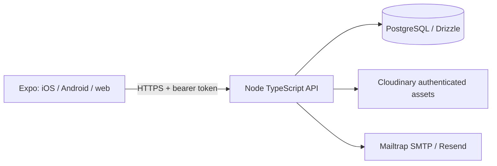

# Architecture

## Request path

The client never connects directly to PostgreSQL, receives a Cloudinary secret, or chooses an asset ownership identifier. Feature modules own their routes, services, and database access. Shared contracts validate inputs on both sides.

## Data model

- `users`: normalized unique email and creation timestamp.
- `otp_challenges`: email, keyed code hash, expiry, failed attempts, and resend timestamp.
- `sessions`: user, token hash, expiry, and creation timestamp.
- `folders`: owner, parent folder, name, color, timestamps. Parent traversal is checked before moves; the database preserves owner relationships.
- `items`: owner, note/file kind, title, note body, extracted text, folder, favorite, trash timestamp, and timestamps. File rows contain `file_source` (`upload` or `reference`), filename, MIME type, bytes, and extraction status. Uploads have a private Cloudinary ID; references have no storage ID and permit zero-byte originals. Note rows leave nullable file fields empty.
- Tags are normalized, deduplicated `text[]` values on each item. A GIN index supports filtering, and the owner-scoped tag endpoint derives facets from active items. There is no separate mutable tag identity in this personal-library model.

Use PostgreSQL full-text search with weighted title/filename/body/tag content and a GIN index. A trigger maintains the search document whenever content or tags change. A second GIN index uses `pg_trgm` for literal partial matches. Parameterize all search input, cap page sizes, and keep stable ordering. Count and page queries share a repeatable-read snapshot.

## Authentication

Use random six-digit email codes, a ten-minute expiry, cooldown, attempt limit, and HMAC hashes with a server-side secret. Serialize challenge updates to prevent concurrent verification bypass. A successful verification consumes its challenge atomically, creates/fetches the user, and issues a random session token. Store only the session hash in the database. Native tokens use Expo SecureStore; web tokens use browser session storage with the limitation documented in security notes.

## Files

Proxy bounded uploads through the authenticated API for a simple ownership boundary. Upload as Cloudinary `authenticated` assets and store provider identifiers, never a public delivery URL. Generate a short-lived signed download URL on authorized requests. Limit extracted text and parsing work; track unsupported/failed extraction without losing the original file. Delete remote assets if metadata persistence fails. Do not promise OCR or semantic search.

## Device file references

References use metadata-only endpoints and the existing folder/tag/search/trash lifecycle. Device paths and permissions never reach the server. Web clients save structured-cloned handles in IndexedDB; native clients use open-mode document picking with persistent Android URI grants or iOS security-scoped bookmarks. Access is scoped locally by account and item. Browser previews sandbox local content; native viewers open originals through the OS. See [file references](FILE_REFERENCES.md).

## Client structure

Use feature hooks for server state and mutations, reusable components for visual primitives, centralized tokens for styling, and a typed API client for transport. Keep network calls out of presentational components. Use a narrow desktop library layout on web and a responsive mobile interface on phones.

## Deployment boundary

Docker PostgreSQL locally; a Neon connection URL with TLS in production. Drizzle migrations are versioned and applied explicitly. API deployment must provide HTTPS, a shared database, persistent secrets, CORS origins, Mailtrap/Resend settings, and Cloudinary credentials. No runtime schema push on startup.
